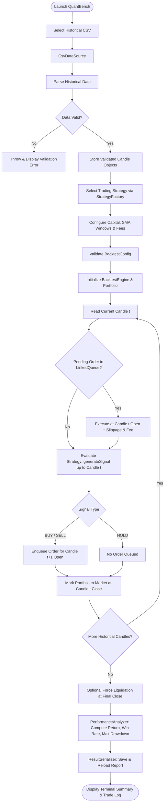
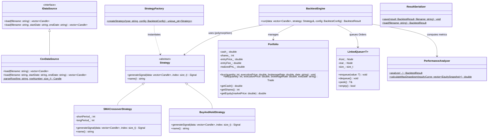

# QuantBench — Modular C++17 Historical Stock-Market Backtesting Engine

**QuantBench** is a modular, event-driven historical stock-market backtesting engine written in **C++17**. It is engineered to demonstrate all 5 modules of an Object-Oriented Programming (IOOP) university curriculum while enforcing quantitative finance realism (zero look-ahead bias, adverse slippage, brokerage commissions, and historical equity drawdown analysis).

---

## 1. What QuantBench Does & How a Backtest Works

A backtester evaluates how a quantitative trading strategy would have performed on historical market data before risking real capital:
1. **Market Data Ingestion**: Reads historical daily OHLCV (`Open, High, Low, Close, Volume`) bars from local CSV files via `CsvDataSource` and validates chronological and numerical integrity.
2. **Event-Driven Simulation Loop (Zero Look-Ahead Bias)**:
   - Iterates chronologically bar-by-bar from earliest to latest date.
   - Any order generated after inspecting the **Close** of Candle $t$ is queued inside a custom templated `LinkedQueue<Order>` and executed at the **Open** of Candle $t+1$ (preventing look-ahead bias).
   - Adverse slippage and percentage brokerage fees are applied on both entry and exit.
   - At the close of each bar, the portfolio is marked to market to record a complete `EquitySnapshot`.
3. **Analytics & Serialization**: Computes Total Return, Net P&L, Win Rate, and Historical Maximum Drawdown, and serializes the complete report to disk via `ResultSerializer`.

---

## 2. Application Flowchart



---

## 3. UML Class Diagram (Module 5)



---

## 4. University IOOP Syllabus Coverage Matrix

| Syllabus Module | Concept | QuantBench Implementation File(s) |
| :--- | :--- | :--- |
| **Module 1** | Encapsulation | `Portfolio.h/.cpp` keeps `cash_`, `shares_`, `entryPrice_`, and `entryFee_` private, exposing validated methods. |
| **Module 1** | Inheritance & Run-time Polymorphism | `SMACrossoverStrategy` and `BuyAndHoldStrategy` inherit from `Strategy`; `BacktestEngine::run` invokes `strategy.generateSignal()` via base reference (late binding). |
| **Module 2** | Static vs. Non-Static Members | `Trade::nextTradeId_` and `Order::nextOrderId_` static counters auto-assign unique IDs across instances. |
| **Module 2** | Method Overloading & Overriding | `CsvDataSource::load(file)` vs `load(file, start, end)`; `Portfolio::buy` overloads; `override` on derived strategy and data methods. |
| **Module 3** | Abstract Classes & Pure Interfaces | `IDataSource` (`include/data/IDataSource.h`) and `Strategy` (`include/strategies/Strategy.h`). |
| **Module 3** | Exception Handling Hierarchy | `CustomExceptions.h` derives `DataFileException`, `DataValidationException`, `ConfigurationException`, `OrderExecutionException`, `SerializationException`, and `EmptyQueueException` from `std::exception`. |
| **Module 4** | Streams & Object Serialization | `CsvDataSource` uses `std::ifstream` & `std::stringstream`; `ResultSerializer` serializes and deserializes `BacktestResult` using `std::ofstream` & `std::ifstream`. |
| **Module 4** | Templates & Custom Data Structures | `LinkedQueue<T>` (`include/structures/LinkedQueue.h`) implements a generic singly-linked FIFO queue with Rule-of-Five RAII memory management. |
| **Module 5** | Design Patterns & Refactoring | **Strategy Pattern** (`Strategy` hierarchy), **Factory Pattern** (`StrategyFactory`), and strict 8-layer separation of concerns. |

---

## 5. How to Build & Run (macOS Clang / Windows MinGW / Linux GCC)

### Option A: Direct Compilation via `g++` or `clang++` (No CMake Required)
Open your terminal in the `QuantBench/` folder and run:

```bash
# 1. Compile the CLI Engine
g++ -std=c++17 -Wall -Wextra -O2 -Iinclude \
    src/data/CsvDataSource.cpp \
    src/portfolio/Portfolio.cpp \
    src/strategies/SMACrossoverStrategy.cpp \
    src/strategies/BuyAndHoldStrategy.cpp \
    src/engine/BacktestEngine.cpp \
    src/analysis/PerformanceAnalyzer.cpp \
    src/persistence/ResultSerializer.cpp \
    src/main.cpp -o quantbench_cli

# 2. Compile and Run the Unit Test Suite
g++ -std=c++17 -Wall -Wextra -O2 -Iinclude \
    src/data/CsvDataSource.cpp \
    src/portfolio/Portfolio.cpp \
    src/strategies/SMACrossoverStrategy.cpp \
    src/strategies/BuyAndHoldStrategy.cpp \
    src/engine/BacktestEngine.cpp \
    src/analysis/PerformanceAnalyzer.cpp \
    src/persistence/ResultSerializer.cpp \
    tests/test_main.cpp tests/test_csv.cpp tests/test_portfolio.cpp \
    tests/test_strategy.cpp tests/test_engine.cpp tests/test_metrics.cpp \
    -o quantbench_tests

./quantbench_tests
```
*(Or simply run `make` and `make test` if `make` is installed!)*

### Option B: Build via CMake
```bash
mkdir -p build && cd build
cmake ..
cmake --build .
ctest --output-on-failure
```

---

## 6. CLI Execution Examples

```bash
# Run default SMA(3/7) backtest on sample_data.csv and save report
./quantbench_cli

# Run Buy and Hold strategy with custom capital and quantity
./quantbench_cli --csv data/sample_data.csv --strategy buy_and_hold --capital 50000 --qty 200

# Run with inclusive date-range filtering
./quantbench_cli --csv data/sample_data.csv --start 2025-01-05 --end 2025-01-22

# Reopen and inspect a saved report file (Deserialization)
./quantbench_cli --load-report reports/sample_report.txt
```

---

## 7. Known Limitations & Future Improvements
* **Long-Only Single Position Scope**: By design for college evaluation clarity, the simulator maintains a single long position at a time without short-selling, margin leverage, or position pyramiding.
* **Daily Bar Resolution**: Orders execute at the next bar's Open price rather than intraday tick-level order book matching.
